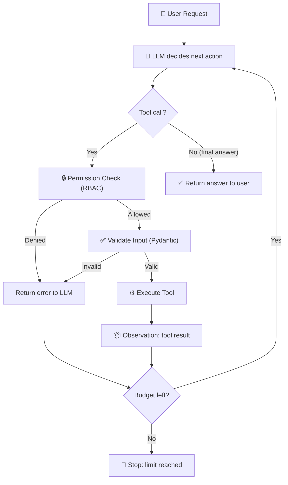
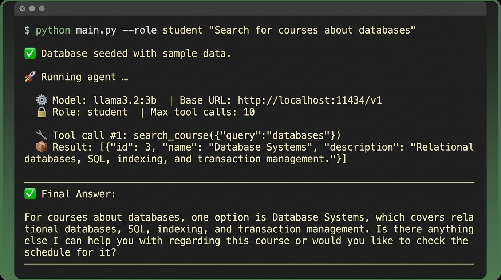
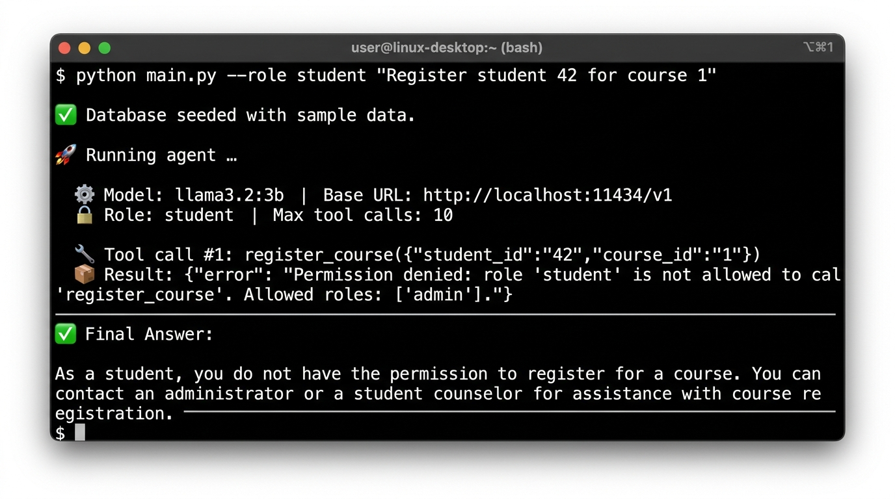
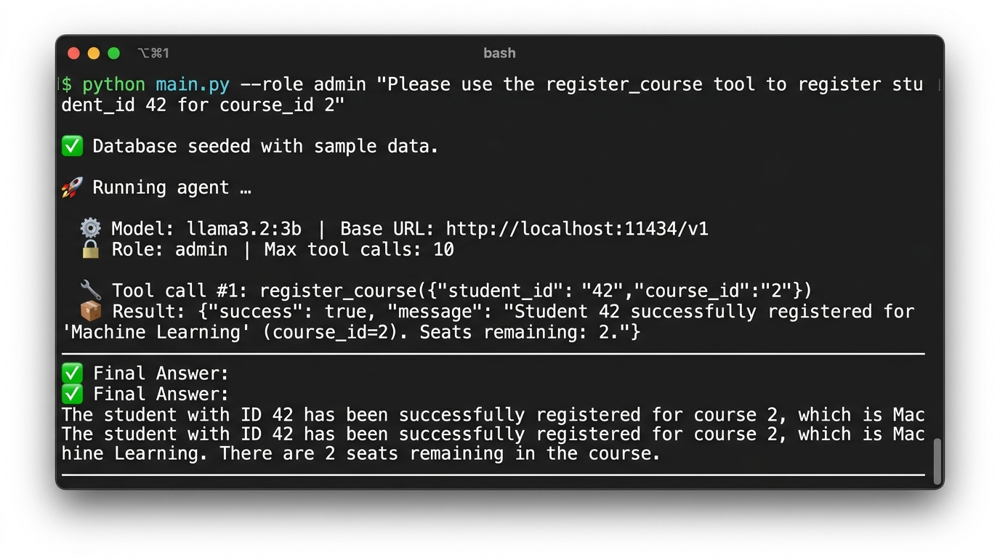

# 🎓 Student Assistant — Simple Agentic Tool-Calling Demo

## 1. Project Overview

**Student Assistant** is a minimal agentic application that demonstrates an LLM-powered tool-calling loop. A user submits a natural-language request about university courses, and the agent — backed by a local LLM running on [Ollama](https://ollama.com) — autonomously decides which tools to call, observes the results, and continues reasoning until it can produce a final answer.

**Key highlights:**

- **3 tools** backed by a SQLite database (search, schedule lookup, registration).
- **Role-based access control (RBAC)** enforced in application code — students cannot register; only admins can.
- **Pydantic input validation** — every tool call is validated before execution.
- **Configurable iteration limit** — prevents runaway loops.
- **Error handling** — all tool and parsing errors are caught and returned as structured messages.

---

## 2. Available Tools

| Tool | Description | Input Schema | Data Source |
| ---- | ----------- | ------------ | ----------- |
| `search_course` | Search the course catalog by keyword (case-insensitive). Returns a list of matching courses with `id`, `name`, and `description`. | `query: str` (1–200 chars, required) | `courses` table |
| `check_schedule` | Look up the weekly schedule (day, time, room, seats available) for a specific course. | `course_id: int` (> 0, required) | `schedules` table |
| `register_course` | Register a student for a course. Checks seat availability and duplicate registration. **Admin only.** | `course_id: int` (> 0), `student_id: int` (> 0) | `registrations` table |

Each tool's input schema is defined as a **Pydantic model** in [`schemas.py`](file:///home/sienghrr/simple-agent-tool/schemas.py) and exported as OpenAI-compatible JSON-schema definitions for the LLM.

---

## 3. Agent Loop

The agent follows a classic **decision → action → observation** loop:



**How it works step-by-step:**

1. The user's request is combined with a system prompt and sent to the LLM.
2. The LLM either returns a **final text answer** (loop ends) or one or more **tool calls**.
3. Each tool call passes through the **harness** ([`harness.py`](file:///home/sienghrr/simple-agent-tool/harness.py)):
   - **Permission check** — is the caller's role allowed to use this tool?
   - **Input validation** — does the input conform to the Pydantic schema?
   - **Execution** — the tool runs and produces a result.
4. The tool result is appended to the conversation as an **observation**.
5. The loop repeats from step 2 — the LLM sees the new observation and decides what to do next.
6. The loop is bounded by `MAX_TOOL_CALLS` (default: 10).

---

## 4. Permission Rule

Role-based access control (RBAC) is enforced **in application code** inside [`harness.py`](file:///home/sienghrr/simple-agent-tool/harness.py#L30-L41), not just in the prompt.

| Action | `student` | `admin` |
| ------ | :-------: | :-----: |
| `search_course` | ✅ | ✅ |
| `check_schedule` | ✅ | ✅ |
| `register_course` | ❌ | ✅ |

**How it works:**

```python
# harness.py — Permission table
PERMISSIONS: dict[str, set[str]] = {
    "search_course":   {"student", "admin"},
    "check_schedule":  {"student", "admin"},
    "register_course": {"admin"},          # ← students blocked here
}
```

When a tool call arrives, the harness checks `role in PERMISSIONS[tool_name]`. If the role is not in the allowed set, the tool call is **rejected with a structured error** — no database query is ever executed.

```
{"error": "Permission denied: role 'student' is not allowed to call 'register_course'. Allowed roles: ['admin']."}
```

---

## 5. Safety

### 5.1 Input Validation (Pydantic)

Every tool input is validated through a Pydantic model before execution. For example:

```python
class CheckScheduleInput(BaseModel):
    course_id: int = Field(..., gt=0, description="...")
```

If validation fails (e.g., `course_id=-1`), the tool returns a structured error without executing:

```
{"error": "Input validation failed: ... Input should be greater than 0 ..."}
```

### 5.2 Error Handling

All errors are caught and returned as structured JSON messages — the agent never crashes:

| Error Type | Handler | Example |
| ---------- | ------- | ------- |
| Unknown tool name | `harness.py` check | `{"error": "Unknown tool 'foo'."}` |
| Permission denied | RBAC table lookup | `{"error": "Permission denied: ..."}` |
| Invalid JSON args | `json.loads` try/except | `{"error": "Invalid JSON arguments: ..."}` |
| Schema validation | Pydantic `ValidationError` | `{"error": "Input validation failed: ..."}` |
| Runtime exception | Catch-all `except Exception` | `{"error": "Tool execution error: ..."}` |

### 5.3 Loop Limit (Max Iterations)

The agent loop is bounded by `MAX_TOOL_CALLS` (configurable via `.env`, default: **10**). This prevents runaway execution if the LLM enters an infinite tool-calling loop.

```python
def check_iteration_budget(current_count: int) -> str | None:
    if current_count >= MAX_TOOL_CALLS:
        return "Tool-call limit reached (10). Stopping the agent loop ..."
    return None
```

The budget is checked **both** before each LLM call and before each individual tool execution.

---

## 6. Example Run

### Example 1: Student searches for courses (success)

```bash
$ python main.py --role student "Search for courses about databases"
```

**Screenshot:**



**Terminal output:**

```
✅ Database seeded with sample data.

🚀 Running agent …

  ⚙️ Model: llama3.2:3b  |  Base URL: http://localhost:11434/v1
  🔒 Role: student  |  Max tool calls: 10

  🔧  Tool call #1: search_course({"query":"databases"})
  📦  Result: [{"id": 3, "name": "Database Systems", "description": "Relational databases, SQL, indexing, and transaction management."}]

──────────────────────────────────────────────────
✅ Final Answer:

For courses about databases, one option is Database Systems, which covers
relational databases, SQL, indexing, and transaction management.
──────────────────────────────────────────────────
```

**What happened:** The LLM decided to call `search_course` with query `"databases"`. The tool searched the SQLite `courses` table, returned one match, and the LLM produced a final answer — all in **1 tool call**.

### Example 2: Student tries to register (permission denied)

```bash
$ python main.py --role student "Register student 42 for course 1"
```

**Screenshot:**



**Terminal output:**

```
✅ Database seeded with sample data.

🚀 Running agent …

  ⚙️ Model: llama3.2:3b  |  Base URL: http://localhost:11434/v1
  🔒 Role: student  |  Max tool calls: 10

  🔧  Tool call #1: register_course({"student_id":"42","course_id":"1"})
  📦  Result: {"error": "Permission denied: role 'student' is not allowed to call 'register_course'. Allowed roles: ['admin']."}

──────────────────────────────────────────────────
✅ Final Answer:

As a student, you do not have the permission to register for a course.
You can contact an administrator or a student counselor for assistance
with course registration.
──────────────────────────────────────────────────
```

**What happened:** The LLM tried to call `register_course`, but the **RBAC check** in `harness.py` blocked it because the role was `student`. The structured error was fed back to the LLM, which explained the situation to the user.

### Example 3: Admin registers a student (success)

```bash
$ python main.py --role admin "Register student_id 42 for course_id 2"
```

**Screenshot:**



**Terminal output:**

```
✅ Database seeded with sample data.

🚀 Running agent …

  ⚙️ Model: llama3.2:3b  |  Base URL: http://localhost:11434/v1
  🔒 Role: admin  |  Max tool calls: 10

  🔧  Tool call #1: register_course({"student_id":"42","course_id":"2"})
  📦  Result: {"success": true, "message": "Student 42 successfully registered for 'Machine Learning' (course_id=2). Seats remaining: 2."}

──────────────────────────────────────────────────
✅ Final Answer:

The student with ID 42 has been successfully registered for course 2,
which is Machine Learning. There are 2 seats remaining in the course.
──────────────────────────────────────────────────
```

**What happened:** With `--role admin`, the RBAC check **passes** for `register_course`. The tool checked seat availability (3 seats), inserted the registration, decremented seats to 2, and returned a success message. Compare with Example 2 where the same tool call was **denied** for a student.

---

## Project Structure

```
simple-agent-tool/
├── .env.example       # Template for .env (copy to .env)
├── .gitignore
├── README.md          # This file
├── pyproject.toml     # Poetry config & dependencies
├── config.py          # Centralised env-var loader
├── database.py        # SQLite init, seed, and query helpers
├── schemas.py         # Pydantic input schemas + OpenAI tool definitions
├── tools.py           # Tool implementations (thin wrappers over DB)
├── harness.py         # RBAC permissions, validation, safety checks
├── agent.py           # Agent loop (LLM ↔ tool call cycle)
└── main.py            # CLI entry point
```

---

## How to Run

### Prerequisites

- **Python 3.10+**
- **Ollama** installed and running ([install guide](https://ollama.com/download))
- **Poetry** for dependency management ([install guide](https://python-poetry.org/docs/#installation))

### Step-by-step

```bash
# 1. Clone the repository
git clone https://github.com/<your-username>/simple-agent-tool.git
cd simple-agent-tool

# 2. Install dependencies
poetry install

# 3. Pull and start the LLM model via Ollama
ollama pull llama3.2:3b        # or qwen3:4b, etc.
ollama serve                    # if not already running

# 4. Configure environment
cp .env.example .env
# Edit .env if needed (change model name, port, etc.)

# 5. Run as a student (interactive mode)
poetry run python main.py --role student

# 6. Run with a one-shot request
poetry run python main.py --role student "Search for courses about databases"

# 7. Run as admin to register a student
poetry run python main.py --role admin "Register student 42 for the Database Systems course"

# 8. Override the model at runtime
poetry run python main.py --role student --model llama3.2:3b "Find machine learning courses"
```

### Configuration (.env)

| Variable | Default | Description |
| -------- | ------- | ----------- |
| `LLM_MODEL` | `qwen3:4b` | Ollama model name |
| `LLM_BASE_URL` | `http://localhost:11434/v1` | Ollama OpenAI-compatible endpoint |
| `LLM_API_KEY` | `ollama` | API key (dummy for local Ollama) |
| `DATABASE_PATH` | `student_assistant.db` | SQLite database file path |
| `MAX_TOOL_CALLS` | `10` | Maximum tool calls per agent run |

---